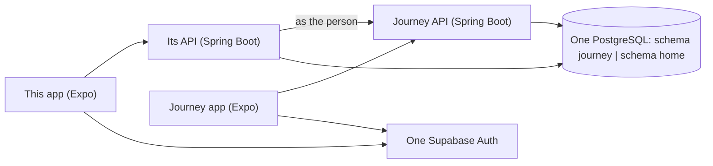

# Tech and costs

> **Status:** proposal. Prices are the ones recorded in Journey's tech doc on 9 Nov 2026, plus one I looked up today and could not confirm on the official page. Check the live price before paying for anything. · **Updated:** 11 Nov 2026
>
> **In one line:** the same stack as Journey, sharing Journey's account system and service accounts, with its own API and its own part of the database.

## Your question: one database, one server?

**Share the account, the database server and every service account. Keep the data and the API apart.**

| | Share it? | How |
|---|---|---|
| **Sign-in** (Supabase Auth) | **Yes** | One Supabase project. A person is the same person in both apps. This is what makes "Continue as Nora", Keep and Tell possible at all. |
| **Database server** (PostgreSQL on Supabase) | **Yes, the server. No, the tables.** | One database, two schemas: `journey` and one for this app. Each API signs in to the database as its own user and has no rights on the other's schema. |
| **The API** (Spring Boot on Fly.io) | **No** | Two small servers. Journey is a public social app with pages anyone can open. This app holds a family's bills and documents. A fault in one should not reach the other. |
| **Photos** (Cloudflare R2) | The account, yes. The buckets, no. | One Cloudflare account, one bucket per app, separate keys |
| **Video** (Mux) | Yes for clips told in Journey | Long home videos are kept as files in R2 instead (see below) |
| **Push, email, analytics, crash reports** | Yes | Same Expo, Resend, PostHog and Sentry accounts, a project in each per app |
| **Apple and Google developer accounts** | Yes | One membership covers both apps |
| **Code** | Partly | Two repos for now. The pieces that are the same (sign-in checks, uploads, the outbox, the design system) are copied first and become a shared library once they have settled. |

### What it saves

| | Fully separate | Shared as above |
|---|---|---|
| Supabase | A second project. Roughly US$10 a month more on the same organisation, or US$25 on its own. | Nothing extra until the database needs a bigger machine |
| Fly.io | About US$7 a month | About US$7 a month (the second small server) |
| Apple, Google, Cloudflare, Resend, Expo, PostHog, Sentry | Fees and free allowances twice in some cases | Once |
| **In all** | | **About US$10 to 35 a month less** at launch size |

The money is small. **The reason to share is the account**: two Supabase projects mean two separate sets of users, and joining them later means building single sign-on yourself.

### What it costs you

- **One busy app can slow the other**, because they share a database machine. At launch size this is not a worry. If it becomes one, a schema moves to its own database in an afternoon, because nothing reaches across.
- **Deleting an account** has to ask "this app, or Journey too?".
- **A database outage takes both apps down.**

### How the two talk

They never read each other's tables. Because both APIs trust the same sign-in, this app's server can ask Journey's API for a journey **as the person**, with that person's own token, and Journey's rules decide the answer. "Keep a journey" is that request plus a save. No back door, and Journey's privacy rules stay in one place.

## The stack

The same as Journey, for the same reasons (Journey's `docs/02-tech-stack.md` has them in full).

| Layer | Choice |
|---|---|
| App | Expo (React Native, TypeScript), iOS and Android |
| API | Spring Boot on Java, on Fly.io. All the rules in one place, with tests. The app never talks to the database. |
| Database and sign-in | PostgreSQL and Auth on Supabase, **Journey's project** |
| Photos and files | Cloudflare R2 |
| Push, email | Expo Push, Resend |
| Design | The same tokens, components and hub as Journey |

## What is new here, and how hard

Journey is a feed of entries. This app has six kinds of thing, live editing and secrets. These are the parts Journey's code does not already answer.

| Part | Approach | How hard |
|---|---|---|
| **Who can see what** | One rule, written once in the API as in Journey's `Rules.java`: every item has an owner, a circle and an audience. Every query uses it. Tested first and most. | Medium, and the most important thing to get right |
| **Live lists and pages** | *As built (12 Nov):* an open list or page asks the API again every few seconds with the version it holds, and gets a short "nothing new" unless something changed. Edits are small operations (tick this, add that), each named by the phone, so two people editing merge instead of overwriting and a change sent twice counts once. A long-lived connection that pushes changes can replace the asking later without changing the screens. | Medium as built. Free text typed by two people into the same paragraph at once is not merged: the later save of that block wins. |
| **Working offline** | Journey's outbox, widened: every change is written on the phone first and sent when it can be | Medium: the pattern exists |
| **The Vault** | *As built (12 Nov):* scrambled in the app with three small libraries, `@noble/curves`, `@noble/ciphers` and `@noble/hashes` (2.4.0 each, MIT, plain JavaScript), instead of libsodium: the same code then runs in Expo Go, in a browser and in a real build, with nothing native to compile. Each item has its own key, wrapped for each person it is shared with. The server holds only scrambled data and public keys. [The protocol](07-vault-protocol.md) has every step. | Hard, and it needs **an outside security review** before real passwords go in. Budget for one. Its questions are listed in the protocol. |
| **"Use without seeing"** | True for Wi‑Fi (the phone joins the network) and for opening a site signed in. A person determined enough could still dig a password out of their own phone, so the screens say "can't see", not "can't get". | Medium. Worth being honest about in the wording. |
| **Sheets** | *As built (12 Nov):* a formula engine of our own, written in Java in the API (`money/sheet`), with the functions the templates and the formula builder use. The app draws the grid and the cards and asks the API for every result, so two phones never disagree about a total. No outside engine, so no licence to clear. Sheets leave as CSV with their formulas as text (in "Export everything"); reading Excel files in is not built. | Done for the first version. More functions are added one at a time, each with its tests. |
| **The wall** | Thumbnails in three sizes, made once (Journey's code does this). The wall asks for a month at a time. | Medium |
| **Moments** | Group by time and place across people in a circle, on the server | Medium |
| **Text inside scans** | *As built (12 Nov):* the API reads a bill's or a document's lines by rules and shows its reading for you to correct. Getting the lines off the picture is the phone's job (Apple Vision, Google ML Kit) and is the one part still to do: it needs a real build, and a library chosen and checked for it. Until then the lines are typed or pasted. | Medium, and it waits for the first phone build |
| **"Type it"** | A date-and-time parser plus a few patterns. No AI service needed for the first version. | Small |
| **Jot: the pinned note** | A notification with a text-reply action on both platforms. On Android it is marked ongoing and re-posted if swiped away. Reading the reply and filing it while the app stays closed needs a little native code on each side. | Medium. Expo's notification library has text-input actions; whether it can handle the reply with the app closed is not checked yet. |
| **Jot: widgets** | Native code on each platform (WidgetKit on iPhone, app widgets on Android), sharing the list data with the app. Buttons and ticks only: neither platform lets a widget take typing. | Medium to hard. This is outside what Expo does by itself; it needs native targets added to the build. |
| **Jot: a list on the Lock Screen** | A Live Activity on iPhone, which Apple limits to 8 hours | Medium, native |
| **Jot: voice** | The phone's own speech recognition, then the same parser, splitting on "and" and commas | Medium |
| **Jot: share from other apps** | A share extension on iPhone and a share target on Android, each with its own small screen | Medium, native |
| **Jot: forwarding an email** | A service that receives mail and hands it to the API. Journey has none; not chosen. | Medium, and a new service to pay for |
| **Noticing a code** | Patterns on the phone ("code", "PIN", "password", runs of digits). When it matches, nothing is sent until the person chooses. | Small |
| **The Saturday jar's weather** | A forecast service, or simply asking "is it raining?" | Small. A forecast is a new service; the question is free. |
| **Same spot, every year** | The camera with last year's photo drawn faintly on top | Small |
| **Grandma's stories** | A web page behind a link that records a voice answer, like Journey's share pages, plus speech-to-text on the server | Medium. Speech-to-text is a new service. |
| **Long videos** | Kept as files in R2 and played from there. Mux charges by the stored minute, which suits Journey's 60-second clips and not a family's hours of video. | Medium, and a cost decision |
| **Faces** | Not in the first version. If wanted: on the phone only. | Hard, and sensitive |
| **Kind of circle** | One field on the circle. The words, starter spaces and suggested templates for each kind live in the app's word catalog and a template catalog, keyed by kind. The rules never read it: sharing works the same for all. | Small. The work is in writing four sets of content. |
| **Hidden answers** (both said yes, Secret Santa, predictions, missions) | The server keeps each person's answer or draw and never sends it to anyone else's phone until the rule says so. The same check as "hidden from". | Medium, and worth its own tests |
| **Filling passwords into other apps** | Needs native code on each platform | Later |

## What it costs to run

Fixed costs barely move when this app joins Journey (see the table above). **Storage is the cost that grows**, and it grows with every family.

| | Journey | This app |
|---|---|---|
| What is kept | A few resized photos per entry, 60-second clips | Every photo and video a family takes, at full size |
| A typical family | | 50 to 200 GB after a year or two |
| R2 at US$0.015 per GB a month | A few dollars for everyone | About US$0.75 to 3 a month **per family** |
| Downloads | Free on R2 | Free on R2 |

So a family plan has to exist. A common shape: a free amount (say 5 to 10 GB, enough to try everything), then a monthly plan for the whole circle. The numbers and the price are yours to set; the point is that "free forever, unlimited" does not add up for this app the way it can for Journey.

## Risks, said plainly

1. **It is a lot.** Six places is several apps' worth of work. Build it in the order in [What it does](01-requirements.md#a-suggested-order), and let each step reach real families before the next.
2. **A password manager is a promise.** If the Vault ships, it has to be right, reviewed, and honest about what "can't see" means.
3. **Private things are less forgiving than public posts.** One wrong rule in "who can see what" shows a child's surprise or a partner's payslip to the wrong person. That rule gets the most tests.
4. **Live editing is hard to do well.** Start with lists, where it matters most and is easiest.
5. ~~The sheet engine's licence~~ No longer a risk: the engine is our own code (12 Nov).
6. **Children who use the app themselves.** A child as a profile a parent looks after is simple. A child under 13 signing in on their own device brings children's privacy rules with it in most countries, and Journey is 13 and over. I have not checked those rules. The design can avoid the question by keeping children as profiles; that choice is yours, and is listed under the questions in [What it does](01-requirements.md#questions-for-you).

## What I checked, and what I didn't

- Journey's stack, services and prices: read from Journey's own tech doc, dated 9 Nov 2026.
- The cost of a second Supabase project: sources say about US$10 a month for a small machine, and disagree on whether the included credit applies per project or per organisation. Not confirmed on Supabase's own pricing page.
- The Vault's libraries (12 Nov): on the npm registry that day, `@noble/curves`, `@noble/ciphers` and `@noble/hashes` were each at 2.4.0 under the MIT licence, with no install scripts and no dependencies beyond each other. Their READMEs name outside audits (Trail of Bits, Cure53, Kudelski); I read that there and did not confirm it elsewhere. They run under the tests, in a browser, and compile into an iOS bundle; they have not run on a phone.
- Not checked: other library versions beyond what the app's own install pins, and Apple's and Google's current rules for apps that store passwords.
- Health (12 Nov): taken out of the app, so there is nothing to check. What was removed and what stayed is in [What it does](01-requirements.md#health-taken-out).
- For Jot (11 Nov): Apple's WidgetKit guide lists buttons and toggles as the controls a widget can have, and I found no report of text fields in widgets in iOS 27. Apple documents a text-reply action for notifications, and says a Live Activity runs for at most 8 hours and stays on the Lock Screen for up to 12. Android 14 made pinned ("ongoing") notifications dismissible, and posting one again brings it back. I read these in documentation and developer write-ups; none of it has been tried on a phone.

## Sources

- Supabase pricing, as summarised by third parties on 11 Nov 2026: <https://makerkit.dev/blog/saas/supabase-pricing>, <https://www.costbench.com/software/database-as-service/supabase/>
- Widgets take buttons and toggles: <https://developer.apple.com/tutorials/data/documentation/widgetkit/adding-interactivity-to-widgets-and-live-activities.md>
- iOS 27 widget changes: <https://9to5mac.com/2026/06/08/ios-27-adds-extra-large-widgets-for-your-extra-large-needs/>
- A text-reply action on a notification: <https://developer.apple.com/documentation/usernotifications/untextinputnotificationaction.md>
- How long a Live Activity lasts: <https://developer.apple.com/documentation/activitykit/displaying-live-data-with-live-activities.md>, <https://developer.apple.com/forums/thread/797676>
- Android 14 and pinned notifications: <https://coderapp.vercel.app/answer/77668315>, <https://groups.google.com/g/automate-user/c/sNZabwadqbU>
